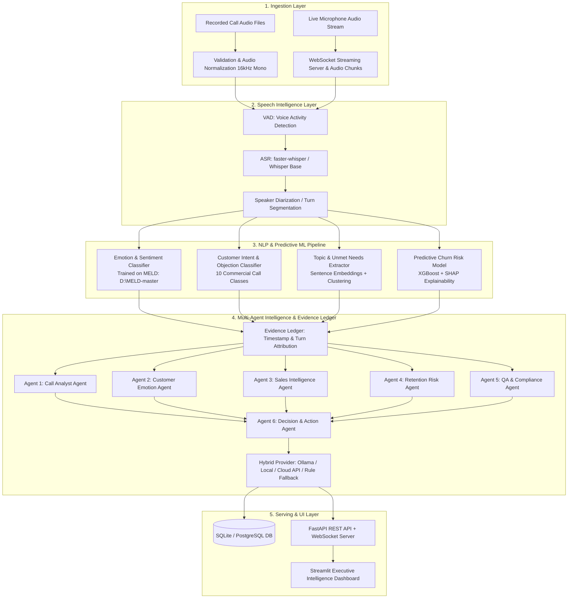

# AI Call Intelligence Engine
> **Turn customer conversations into actionable business intelligence — not just transcripts.**

---

## 1. Executive Summary & Design Scope

The **AI Call Intelligence Engine** is a comprehensive Data Science, Speech AI, Predictive ML, and Multi-Agent platform designed to analyze recorded and live customer calls across **Customer Support**, **Sales**, and **Retention**.

### Core Choices
- **Input Channels**: Both recorded call audio files (`.wav`, `.mp3`) and live microphone/browser streaming via WebSocket.
- **Target Domains**: Customer Support (ticket categorization, escalation, QA), Sales (buying signals, objections, competitor tracking), Retention (cancellation risk, churn mitigation).
- **Deployment**: Hybrid architecture — local-first models (`faster-whisper`, scikit-learn, XGBoost, local Ollama) with seamless optional cloud LLM API fallback.
- **Deliverable**: Full portfolio project with FastAPI backend, WebSocket streaming, PostgreSQL/SQLite database, and an executive Streamlit Analytics Dashboard with an auditable **Evidence Ledger**.
- **Speech Emotion & Conversation Dataset**: Ingested directly from **`D:\MELD-master`** (13,708 multi-turn conversation utterances across 1,432 dialogues).

---

## 2. System Architecture



---

## 3. Dataset Architecture

### Primary Dataset: MELD (`D:\MELD-master`)
- **Location**: `D:\MELD-master\data\MELD`
- **Volume**: 13,708 utterances across 1,432 dialogues.
  - **Train**: 9,989 utterances (1,038 dialogues)
  - **Dev**: 1,109 utterances (114 dialogues)
  - **Test**: 2,610 utterances (280 dialogues)
- **Annotations**:
  - `Emotion`: 7 discrete emotions (`neutral`, `joy`, `surprise`, `anger`, `sadness`, `disgust`, `fear`)
  - `Sentiment`: 3 polarity classes (`positive`, `neutral`, `negative`)
  - `Speaker`, `StartTime`, `EndTime` for turn-by-turn conversation dynamics.
- **Ingestion**: Automated via `training/ingest_meld.py` into `data/meld/`.

### Supplementary Datasets
1. **Commercial Call Intent Dataset**: 10-class intent taxonomy (Pricing Objections, Cancellation Warnings, Feature Requests, Bug Reports, Account Access, Upgrade Inquiries, Competitor Comparisons, Service Complaints, Product Questions, General Inquiries).
2. **Customer Churn Dataset**: Supervised tabular dataset (`bank_churn_cleaned.csv`) for training XGBoost risk scoring with SHAP feature attributions.

---

## 4. Repository & Directory Structure

```text
e:\ai\
├── README.md                           # Project documentation & architecture
├── requirements.txt                    # Pinned Python dependencies
├── pyproject.toml                      # Package build configuration
├── configs/
│   ├── app_config.yaml                 # Application & server configuration
│   └── models_config.yaml              # Model hyperparameters & paths
├── data/
│   ├── meld/                           # Processed MELD dataset from D:\MELD-master
│   │   ├── meld_train_dialogues.json   # 1,038 dialogues (9,989 turns)
│   │   ├── meld_dev_dialogues.json     # 114 dialogues (1,109 turns)
│   │   ├── meld_test_dialogues.json    # 280 dialogues (2,610 turns)
│   │   └── meld_summary_metadata.json  # Class distributions & metadata
│   ├── churn/                          # Tabular churn data for predictive ML
│   └── samples/                        # Synthetic sample audio (.wav) for demos
├── src/
│   └── callintel/
│       ├── core/                       # App settings, logging, PII security
│       ├── schemas/                    # Pydantic schemas (Transcript, Turn, Evidence)
│       ├── speech/                     # faster-whisper, VAD, audio normalization
│       ├── ml/                         # Emotion, Intent, Churn & Topic models
│       ├── agents/                     # 6 specialized agents + supervisor
│       ├── providers/                  # Hybrid LLM interface (Ollama / Cloud / Rule Fallback)
│       ├── db/                         # SQLAlchemy ORM models & repository
│       ├── api/                        # FastAPI routes & WebSocket streamer
│       └── services/                   # Audio pipeline & live session manager
├── dashboard/
│   ├── app.py                          # Streamlit application entrypoint
│   ├── components/                     # Audio player, Evidence Ledger widget
│   └── pages/                          # Multi-page dashboard views
├── training/
│   ├── ingest_meld.py                  # Ingestion script for D:\MELD-master
│   ├── train_emotion.py                # Emotion classifier training
│   ├── train_intent.py                 # Intent classifier training
│   └── train_churn.py                  # XGBoost churn model + SHAP explainer
└── tests/
    ├── unit/                           # Audio processing & schema tests
    ├── integration/                    # Pipeline end-to-end tests
    └── api/                            # REST & WebSocket tests
```

---

## 5. Technology Stack & Dependencies

- **Language**: Python 3.12 (64-bit)
- **Audio & Speech**: `faster-whisper`, `soundfile`, `webrtcvad-wheels`
- **Data Science & ML**: `numpy`, `pandas`, `scikit-learn`, `xgboost`, `lightgbm`, `shap`
- **NLP & Transformers**: `torch`, `transformers`, `sentence-transformers`
- **API & Streaming**: `fastapi`, `uvicorn[standard]`, `websockets`, `pydantic`
- **Dashboard**: `streamlit`, `plotly`
- **Database**: `sqlalchemy`, `sqlite3` (prototype) / `psycopg` (production)
- **Testing**: `pytest`, `pytest-asyncio`, `httpx`

---

## 6. Implementation Milestones

| Milestone | Focus | Key Deliverables |
| :--- | :--- | :--- |
| **Milestone 1: Foundation & Datasets** | Data Ingestion & Schemas | Ingest `D:\MELD-master`, build schemas, PII redaction filter, project skeleton. |
| **Milestone 2: Speech & NLP MVP** | Transcription & Emotion | `faster-whisper` transcription, MELD-trained emotion/sentiment inference engine. |
| **Milestone 3: Predictive ML & SHAP** | Intent & Churn Prediction | Intent classifier, XGBoost churn risk predictor with SHAP waterfall explanations. |
| **Milestone 4: Multi-Agent Engine** | Specialized Agents & Evidence Ledger | 6 AI agents, auditable Evidence Ledger linking claims to timestamps, hybrid provider. |
| **Milestone 5: API & Live Streaming** | FastAPI & WebSockets | Async upload endpoints, WebSocket live microphone streaming and incremental turns. |
| **Milestone 6: Executive Dashboard** | Streamlit UI & Release | Interactive call player, synchronized Evidence Ledger, KPI views, model evaluation tab. |

---

## 7. Testing & Quality Strategy

1. **Unit Tests**:
   - Audio normalization: sample rate conversion to 16kHz mono.
   - PII filtering: automatic masking of credit cards, phone numbers, and SSNs.
   - Schema validation: verify Evidence Ledger timestamps and turn index consistency.
2. **ML Evaluation**:
   - MELD Emotion/Sentiment: Macro-F1 and confusion matrix evaluated on `test_sent_emo.csv`.
   - Churn Model: PR-AUC, ROC-AUC, and Brier calibration score.
   - Grounding Gate: 100% of generated business recommendations must cite at least one verified Evidence Ledger excerpt.
3. **Integration & WebSocket Tests**:
   - Full pipeline execution: Audio -> Transcribe -> Turn Extraction -> ML Inference -> Agent Ledger -> DB Save.
   - Streaming stability: Reconnection handling and low latency (< 1.5s per chunk).
