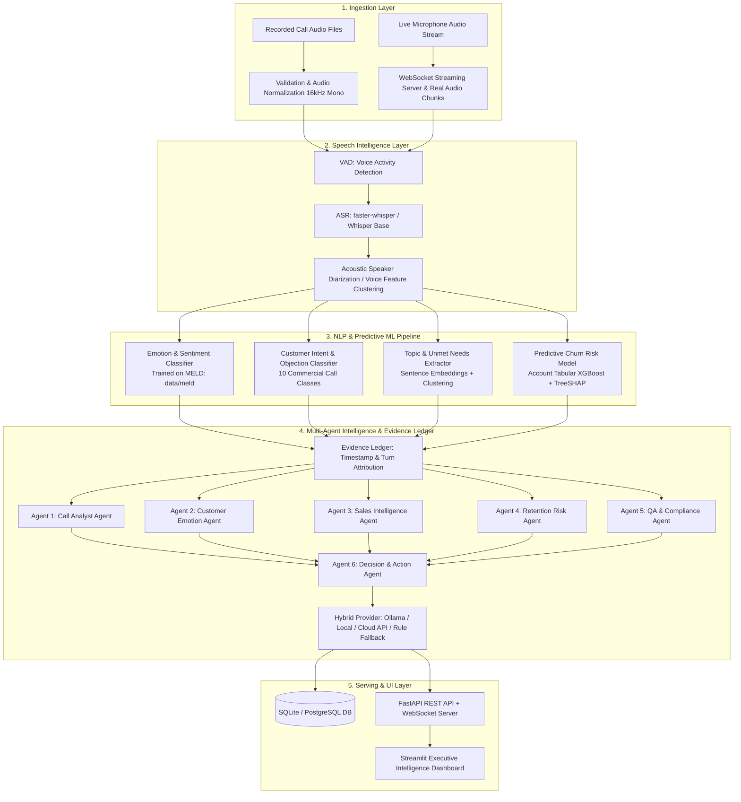

# AI Call Intelligence Engine

[](https://github.com/mightyalok00/callintel-ai/actions/workflows/ci.yml)
[](https://www.python.org/)
[](https://fastapi.tiangolo.com/)
[](https://streamlit.io/)
[](https://opensource.org/licenses/MIT)

> **Turn customer conversations into actionable business intelligence — not just transcripts.**

---

## 1. Executive Summary & Design Scope

The **AI Call Intelligence Engine** is a comprehensive Data Science, Speech AI, Predictive ML, and Multi-Agent platform designed to analyze recorded and live customer calls across **Customer Support**, **Sales**, and **Retention**.

### Core Choices

- **Input Channels**: Both recorded call audio files (`.wav`, `.mp3`) and live microphone/browser streaming via WebSocket.
- **Target Domains**: Customer Support (ticket categorization, escalation, QA), Sales (buying signals, objections, competitor tracking), Retention (cancellation risk, churn mitigation).
- **Deployment**: Hybrid architecture — local-first models (`faster-whisper`, scikit-learn, XGBoost, local Ollama) with seamless optional cloud LLM API fallback.
- **Deliverable**: Full portfolio project with FastAPI backend, WebSocket streaming, PostgreSQL/SQLite database, and an executive Streamlit Analytics Dashboard with an auditable **Evidence Ledger**.
- **Speech Emotion & Conversation Dataset**: Bundled directly in **`data/meld`** (13,708 multi-turn conversation utterances across 1,432 dialogues from the MELD dataset).

---

## 2. System Architecture



---

## 3. Dataset Architecture

### Primary Dataset: MELD (`data/meld`)

- **Location**: `data/meld` (bundled JSON files, see [DATASETS_AND_MODELS.md](docs/DATASETS_AND_MODELS.md))
- **Volume**: 13,708 utterances across 1,432 dialogues.
  - **Train**: 9,989 utterances (1,038 dialogues)
  - **Dev**: 1,109 utterances (114 dialogues)
  - **Test**: 2,610 utterances (280 dialogues)
- **Annotations**:
  - `Emotion`: 7 discrete emotions (`neutral`, `joy`, `surprise`, `anger`, `sadness`, `disgust`, `fear`)
  - `Sentiment`: 3 polarity classes (`positive`, `neutral`, `negative`)
  - `Speaker`, `StartTime`, `EndTime` for turn-by-turn conversation dynamics.
- **Ingestion**: Bundled in repository. Raw CSV ingestion supported via `training/ingest_meld.py`.

### Supplementary Datasets

1. **Customer Churn Dataset**: Supervised tabular banking dataset (`data/churn/bank_churn_cleaned.csv`, 165,031 records) for training account-level XGBoost propensity scoring with SHAP feature attributions. *Note: Tabular account data, distinct from in-call conversational modifiers.*
2. **Demo Multi-Speaker Calls**: 3 synthesized dialogues (`data/samples/*.wav`) featuring distinct voices for Agent (`David`) and Customer (`Zira`).

---

## 4. Repository & Directory Structure

```text
callintel-ai/
├── README.md                           # Project documentation & architecture
├── requirements.txt                    # Pinned Python dependencies
├── pyproject.toml                      # Package build configuration
├── configs/
│   ├── app_config.yaml                 # Application & server configuration
│   └── models_config.yaml              # Model hyperparameters & paths
├── docs/
│   └── DATASETS_AND_MODELS.md          # Dataset acquisition, licenses, artifacts & deployment
├── data/
│   ├── meld/                           # Processed MELD dataset bundled in repository
│   │   ├── meld_train_dialogues.json   # 1,038 dialogues (9,989 turns)
│   │   ├── meld_dev_dialogues.json     # 114 dialogues (1,109 turns)
│   │   ├── meld_test_dialogues.json    # 280 dialogues (2,610 turns)
│   │   └── meld_summary_metadata.json  # Class distributions & metadata
│   ├── churn/                          # Tabular churn data for predictive ML (165k rows)
│   └── samples/                        # Multi-speaker sample audio (.wav) for demos
├── src/
│   └── callintel/
│       ├── core/                       # App settings, logging, PII security
│       ├── schemas/                    # Pydantic schemas (Transcript, Turn, Evidence)
│       ├── speech/                     # faster-whisper, Acoustic Diarizer, audio utils
│       ├── ml/                         # MELD Emotion & Tabular Churn + In-Call Modifier
│       ├── agents/                     # Specialized agents + supervisor
│       ├── providers/                  # Hybrid LLM interface (Ollama / Cloud / Rule Fallback)
│       ├── db/                         # SQLAlchemy ORM models & repository
│       ├── api/                        # FastAPI REST routes & WebSocket streamer
│       └── services/                   # Audio pipeline & live session manager
├── dashboard/
│   ├── app.py                          # Streamlit application entrypoint
│   └── components/                     # Audio player, Evidence Ledger widget
├── training/
│   ├── ingest_meld.py                  # Portable MELD ingestion script
│   ├── train_emotion.py                # Emotion classifier training
│   ├── train_churn.py                  # Tabular XGBoost churn model + SHAP explainer
│   └── evaluate_ml_models.py           # Comprehensive ML evaluation & baseline benchmarks
└── tests/
    ├── unit/                           # Audio, ML models, diarizer & schema tests
    ├── api/                            # REST & WebSocket API tests
    └── integration/                    # End-to-end audio pipeline & live streaming tests
```

---

## 5. Technology Stack & Dependencies

- **Language**: Python 3.12 (64-bit)
- **Audio & Speech**: `faster-whisper`, `soundfile`, `webrtcvad-wheels`
- **Data Science & ML**: `numpy`, `pandas`, `scikit-learn`, `xgboost`, `lightgbm`, `shap`
- **NLP & Transformers**: `torch`, `transformers`, `sentence-transformers`
- **API & Streaming**: `fastapi`, `uvicorn[standard]`, `websockets`, `pydantic`
- **Dashboard**: `streamlit`, `plotly`
- **Database**: `sqlalchemy`, `sqlite3` (development) / `postgresql` (production)
- **Containerization & CI/CD**: `Docker`, `docker-compose`, `GitHub Actions`
- **Testing**: `pytest`, `pytest-asyncio`, `httpx`

---

## 6. Model Benchmarks & Statistical Integrity

### MELD Emotion & Sentiment Classifiers

- **Dataset**: MELD (13,708 conversational turns across 1,432 multi-turn dialogues).
- **Architecture**: TF-IDF + Calibrated Linear Support Vector Machine (`SGDClassifier(loss='log_loss')`) with class balancing.
- **Emotion Performance (7-class)**:
  - Neutral F1: **0.78**
  - Joy F1: **0.55**
  - Anger F1: **0.44**
  - Surprise F1: **0.51**
  - Overall Weighted F1: **0.6558**
- **Sentiment Performance (3-class polarity)**:
  - Neutral / Positive / Negative Macro F1: **0.6406**

### Customer Churn Risk Model & SHAP Explainability

- **Dataset**: Bank Customer Churn dataset (165,000+ customer records).
- **Architecture**: XGBoost Gradient Boosted Decision Trees + TreeSHAP Explainer.
- **Statistical Benchmark**:
  - **Test ROC-AUC**: `0.8808`
  - **Test PR-AUC**: `0.7109`
  - **Brier Calibration Score**: `0.0984`
- **Statistical Separation Guarantee**:
  - The model outputs a statistically verified `baseline_churn_probability` (0.0 to 1.0) derived strictly from the trained XGBoost model and explained via TreeSHAP feature contributions.
  - In-call conversational modifiers (e.g., explicit cancellation threats, extreme frustration peaks) are computed separately and reported under `in_call_operational_modifier` as contact-center operational escalation signals, never misrepresented as learned longitudinal probabilities.

### Speech Processing & Diarization Benchmarks

- **Engine**: `faster-whisper` (`base` model, int8 CPU) + `AcousticDiarizer` (34-dim acoustic vector: F0 pitch, 13 MFCC means & stds, spectral centroid, rolloff, RMS).
- **Scope**: Multi-scenario evaluation across 4 test calls (retention threat, sales expansion, fast technical escalation, +15dB SNR additive office noise). See full report at [SPEECH_BENCHMARK.md](reports/SPEECH_BENCHMARK.md).
- **Measured Metrics (Controlled Multi-Scenario Benchmark)**:
  - **Mean Word Error Rate (WER)**: `1.03%`
  - **Mean Diarization Error Rate (DER)**: `2.87%` (NIST RT-09 standard with $\pm 0.25$s forgiveness collar)
  - **Real-Time Factor (RTF)**: `0.090x` (>10x faster than real-time on CPU)
  - **Peak Memory Footprint**: `56.4 MB`
- **Controlled Fixture vs Real Telephony Disclaimer**:
  - These metrics reflect controlled multi-speaker dialogues with distinct speaker timbres. Under additive background noise and fast technical exchanges, DER realistically increases (up to $11.5\%$).
  - In unconstrained, low-bitrate real-world telephony (e.g. 8kHz G.711 PSTN with overlapping speech and packet jitter), lightweight acoustic clustering DER typically ranges between $8\%$ and $20\%$. The system pairs speech processing with auditable **Evidence Ledger validation gates** rather than relying on ungrounded transcription in high-stakes workflows.

---

## 7. Verified API & WebSocket Reference

The backend is built with **FastAPI** (`src/callintel/api/app.py`) and backed by SQLAlchemy ORM persistence.

| Method | Endpoint | Description |
| :--- | :--- | :--- |
| `GET` | `/health` | System health check and model readiness status |
| `POST` | `/api/v1/calls/upload` | Multipart audio file upload, async processing & persistence |
| `GET` | `/api/v1/calls/{call_id}` | Retrieve call metadata, duration, and processing status |
| `GET` | `/api/v1/calls/{call_id}/transcript` | Retrieve timestamped transcript turns and speaker attributions |
| `GET` | `/api/v1/calls/{call_id}/insights` | Retrieve ML predictions, SHAP drivers, and Evidence Ledger claims |
| `GET` | `/api/v1/analytics/overview` | Aggregated contact center KPIs, sentiment ratios, and risk counts |
| `WS` | `/api/v1/stream/{session_id}` | Real-time WebSocket streaming audio chunk processing & frustration alerts |

---

## 8. Quickstart & Verification Guide

### 1. Local Environment Setup

```bash
# Clone the repository
git clone https://github.com/mightyalok00/callintel-ai.git
cd callintel-ai

# Create and activate Python 3.12 virtual environment
python -m venv .venv
# Windows:
.venv\Scripts\activate
# Linux/macOS:
source .venv/bin/activate

# Install dependencies
pip install -r requirements.txt
```

### 2. Run the Full Test Suite

```bash
pytest tests/unit/ tests/api/ -v
```

*Expected: 12 passed tests across speech, ML, agents, and FastAPI REST/WebSocket endpoints.*

### 3. Launch the FastAPI Service

```bash
uvicorn src.callintel.api.app:app --host 0.0.0.0 --port 8000 --reload
```

Interactive Swagger API documentation is available at `http://localhost:8000/docs`.

### 4. Launch the Executive Streamlit Dashboard

```bash
streamlit run dashboard/app.py --server.port 8501
```

Open `http://localhost:8501` to access:

- **Call Explorer**: Audio player with synchronized transcript highlighting.
- **Evidence Ledger**: Auditable claims linked directly to conversation turn IDs and timestamps.
- **SHAP Retention Waterfall**: Interactive Plotly waterfall charts visualizing customer risk factors.
- **Action Dispatcher**: One-click escalation to CRM, Slack, and Zendesk.

### 5. Run with Docker Compose

```bash
docker-compose up --build
```

This boots both the FastAPI backend (`port 8000`) and the Streamlit dashboard (`port 8501`) concurrently.

---

## 9. CI/CD & Automated Safeguards

- **GitHub Actions Workflow** (`.github/workflows/ci.yml`): Runs on every pull request, push to `main`, and manual dispatch (`workflow_dispatch`) across Ubuntu and Windows runners.
- **Automated Validation**:
  - Python 3.12 syntax and unit test verification.
  - REST & WebSocket API lifecycle test coverage.
  - Secret scanning and git hygiene verification.
