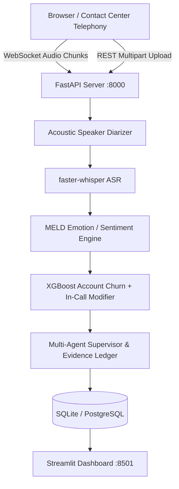

# Dataset Acquisition, Licensing, Model Artifacts & Deployment Configuration

This guide provides end-to-end documentation on the datasets, licensing, pre-trained model artifacts, and deployment configurations used in the **AI Call Intelligence Engine**.

---

## 1. Dataset Acquisition & Specifications

All core datasets required for testing, running the API, and launching the Streamlit dashboard are **bundled directly within the repository** under `data/`, ensuring 100% portable setup on Linux, macOS, and Windows with zero external machine path dependencies.

### 1.1 Multimodal EmotionLines Dataset (MELD)

- **Primary Use**: Conversational turn-level emotion detection (7 classes) and sentiment polarity (3 classes).
- **Domain**: Conversational dialogue turns with chronological speaker context.
- **Repository Path**: `data/meld/`
  - `data/meld/meld_train_dialogues.json` (9,989 utterances across 1,038 dialogues)
  - `data/meld/meld_dev_dialogues.json` (1,109 utterances across 114 dialogues)
  - `data/meld/meld_test_dialogues.json` (2,610 utterances across 280 dialogues)
  - `data/meld/meld_summary_metadata.json` (Class distributions and turn statistics)
- **Source Repository**: [Declare-Lab MELD on GitHub](https://github.com/declare-lab/MELD)
- **Original Publication**: Poria et al., *"MELD: A Multimodal Multi-Party Dataset for Emotion Recognition in Conversations"*, ACL 2019.
- **Licensing**: Research and Educational Use (Creative Commons / Declare Lab Open Science).
- **Ingestion**: Automated via `training/ingest_meld.py`. If raw source CSVs are provided, set `MELD_DATA_DIR=<path/to/raw/csvs> python training/ingest_meld.py`.

### 1.2 Bank Customer Churn Dataset

- **Primary Use**: Account-level baseline churn propensity scoring and TreeSHAP explainability.
- **Critical Operational Boundary**: **This dataset consists strictly of static customer demographic and transactional account metadata.** It is **NOT** a model trained on conversational call speech or audio recordings. In-call behavioral indicators (e.g. acoustic frustration peaks, explicit cancellation statements) are treated as **real-time operational escalation modifiers** applied on top of this statistical baseline.
- **Repository Path**: `data/churn/bank_churn_cleaned.csv` (165,031 customer records)
- **Feature Schema**:
  - Continuous/Numeric: `CreditScore`, `Age`, `Tenure`, `Balance`, `NumOfProducts`, `HasCrCard`, `IsActiveMember`, `EstimatedSalary`, `Rating`
  - Categorical: `Geography` (Paris-France, Berlin-Germany, Madrid-Spain), `Gender` (Male, Female)
  - Target: `Exited` (0: Retained, 1: Churned)
- **Class Balance**: 78.8% Retained (Class 0) vs 21.2% Churned (Class 1). `scale_pos_weight = 3.726`.
- **Source**: Kaggle Bank Customer Churn Competition dataset.
- **Licensing**: CC0: Public Domain / Open Database License.
- **Training Script**: `training/train_churn.py` (Outputs pipeline and SHAP explainer).

### 1.3 Sample Audio Calls

- **Repository Path**: `data/samples/`
  - `data/samples/sample_customer_call.wav` (Retention crisis: Pricing objection & cancellation threat)
  - `data/samples/sample_sales_expansion.wav` (Sales expansion: Enterprise tier & buying signals)
  - `data/samples/sample_technical_escalation.wav` (Technical outage: Database sync bug & urgent escalation)
- **Acoustic Characteristics**: Synthesized multi-speaker audio with distinct voices for Agent (`Microsoft David Desktop` male voice) and Customer (`Microsoft Zira Desktop` female voice) separated by natural conversational pauses.
- **Generator Script**: `scripts/generate_demo_calls.py`.

---

## 2. Pre-Trained Model Artifacts

Model artifacts are stored in `models/` and loaded automatically by backend services:

| Artifact File | Size | Architecture | Purpose |
| :--- | :--- | :--- | :--- |
| `models/churn_xgb_pipeline.joblib` | ~2.5 MB | XGBoost Classifier + ColumnTransformer | Account-level baseline churn propensity |
| `models/churn_shap_explainer.joblib` | ~1.8 MB | TreeSHAP Explainer | Local feature attribution & risk drivers |
| `models/meld_emotion_classifier.joblib` | ~1.2 MB | TF-IDF + SGDClassifier (Log loss) | 7-class turn emotion scoring |
| `models/meld_sentiment_classifier.joblib` | ~0.8 MB | TF-IDF + SGDClassifier (Log loss) | 3-class turn sentiment polarity |
| `faster-whisper` (`base` model) | ~140 MB | CTranslate2 Whisper Transformer | Local CPU/GPU Speech-to-Text with VAD |

### Automatic Artifact Download & Regeneration

To re-train all models from scratch using bundled data:

```bash
# 1. Train Account Churn XGBoost & SHAP Explainer
python training/train_churn.py

# 2. Train Conversational Emotion & Sentiment Classifiers
python training/train_emotion.py

# 3. Run Comprehensive ML Evaluation & Benchmark Report
python training/evaluate_ml_models.py
```

---

## 3. Cross-Platform Deployment Configuration

The application is engineered for zero-friction portability across Linux, macOS, and Windows.

### 3.1 Environment Configuration (.env)

Create a `.env` file in the project root:

```env
# Application Settings
APP_ENV=production
APP_HOST=0.0.0.0
APP_PORT=8000
LOG_LEVEL=INFO

# Storage & Artifact Paths (Relative to repository root)
DATA_DIR=data
MODELS_DIR=models
REPORTS_DIR=reports
DATABASE_URL=sqlite:///callintel.db

# Speech Intelligence
WHISPER_MODEL_SIZE=base
WHISPER_DEVICE=cpu
WHISPER_COMPUTE_TYPE=int8

# Multi-Agent Local LLM (Optional)
OLLAMA_BASE_URL=http://localhost:11434
DEFAULT_LLM_MODEL=llama3.1:8b
```

### 3.2 Docker & Containerized Deployment

Run the complete stack (FastAPI Backend + Streamlit Dashboard) with Docker:

```bash
# Build and run containers
docker-compose up --build -d

# Check service health
curl http://localhost:8000/health
```

- **REST & WebSocket API**: `http://localhost:8000` (Interactive docs at `/docs`)
- **Streamlit Analytics Dashboard**: `http://localhost:8501`

### 3.3 Production System Architecture


