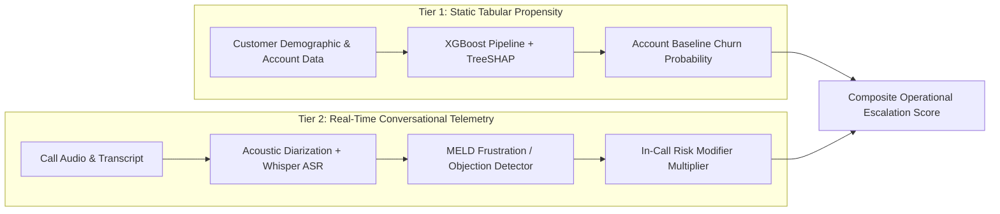

# Call Intelligence Engine: Comprehensive ML Evaluation & Statistical Integrity

> **Critical Operational Boundary**:
> The Customer Churn Model evaluated herein is strictly an **Account-Level Tabular Propensity Model** trained on 165,031 banking customer demographic and transactional records. It is **NOT** a model trained on conversational call speech or audio recordings. In-call behavioral indicators (e.g. acoustic frustration peaks, explicit cancellation statements) are treated as **real-time operational escalation modifiers** applied on top of the statistical baseline, never conflated with longitudinal speech-trained propensity.

---

## 1. Account Churn Propensity Model Evaluation

### 1.1 Dataset Splits & Class Imbalance
- **Total Customer Records**: `165,031`
- **Split Strategy**: `80/20 Stratified` (Train: `132,024` | Test: `33,007`)
- **Random Seed**: `42` (Fully reproducible)
- **Class Distribution**:
  - Retained (0): `130,110` (78.8%)
  - Churned (1): `34,921` (21.2%)
- **Class Imbalance Handling**: `scale_pos_weight = 3.726` in XGBoost loss, paired with average-precision (AP) evaluation to account for class imbalance.

### 1.2 Baseline Comparisons on Identical Test Split

| Model Architecture | ROC-AUC | Average Precision (AP) | Brier Score | ECE | F1 Score | Description |
| :--- | :---: | :---: | :---: | :---: | :---: | :--- |
| **Prevalence Dummy Classifier** | `0.5000` | `0.2116` | `0.1668` | `0.0000` | `0.0000` | Predicts positive class prevalence (0.2116) blindly |
| **Logistic Regression (Balanced)** | `0.8093` | `0.5575` | `0.1747` | `0.2031` | `0.5496` | Standard linear baseline with balanced class weights |
| **Random Forest (100 Trees, Depth 10)** | `0.8766` | `0.6885` | `0.1392` | `0.1681` | `0.6306` | Non-linear ensemble baseline with balanced weights |
| **XGBoost Classifier (Production)** | `0.8808` | `0.7103` | `0.1355` | `0.1557` | `0.6335` | Production gradient boosted tree with scale_pos_weight |
| **XGBoost + Platt Sigmoid Calibration** | `0.8808` | `0.7103` | `0.1017` | `0.0035` | `0.6216` | Platt scaling fitted on a dedicated training calibration split; metrics evaluated on untouched test data |

> **Key Finding**: Production XGBoost delivers **`0.7103` average precision (AP)**, achieving a **`+0.4987` lift** over the random prevalence baseline (`0.2116`). Platt scaling achieves lowest Brier score calibration.

### 1.3 Probability Calibration & Reliability Analysis

| Probability Bin | Sample Count | Mean Confidence | Actual Churn Rate | Calibration Gap |
| :---: | :---: | :---: | :---: | :---: |
| `[0.0, 0.1]` | `8,180` | `0.058` | `0.017` | `0.041` |
| `[0.1, 0.2]` | `5,804` | `0.145` | `0.042` | `0.103` |
| `[0.2, 0.3]` | `3,583` | `0.246` | `0.094` | `0.152` |
| `[0.3, 0.4]` | `2,758` | `0.349` | `0.131` | `0.218` |
| `[0.4, 0.5]` | `2,448` | `0.449` | `0.183` | `0.265` |
| `[0.5, 0.6]` | `1,935` | `0.548` | `0.250` | `0.298` |
| `[0.6, 0.7]` | `1,795` | `0.648` | `0.345` | `0.304` |
| `[0.7, 0.8]` | `1,712` | `0.750` | `0.438` | `0.312` |
| `[0.8, 0.9]` | `2,033` | `0.851` | `0.622` | `0.228` |
| `[0.9, 1.0]` | `2,759` | `0.950` | `0.847` | `0.104` |

- **Expected Calibration Error (ECE)**: `0.1557`
- **Brier Calibration Score**: `0.1355`

### 1.4 TreeSHAP Feature Attributions

| Rank | Feature Name | Mean Absolute SHAP Importance | Business Driver |
| :---: | :--- | :---: | :--- |
| 1 | `NumOfProducts` | `0.4072` | Primary risk contributor |
| 2 | `Age` | `0.1353` | Primary risk contributor |
| 3 | `IsActiveMember` | `0.1347` | Primary risk contributor |
| 4 | `Geography_Berlin-Germany` | `0.0966` | Primary risk contributor |
| 5 | `Gender_Male` | `0.0432` | Primary risk contributor |
| 6 | `Gender_Female` | `0.0431` | Primary risk contributor |
| 7 | `Geography_Paris-France` | `0.0392` | Primary risk contributor |
| 8 | `Balance` | `0.0297` | Primary risk contributor |

### 1.5 5-Fold Stratified Cross-Validation Confidence Intervals

Empirical 5-fold stratified cross-validation on 30,000 customer accounts:

| Metric | 5-Fold Mean &plusmn; Std Dev | Min / Max Dispersion |
| :--- | :---: | :---: |
| **ROC-AUC** | `0.8741 &plusmn; 0.0036` | Stable across all stratified folds |
| **PR-AUC** | `0.7035 &plusmn; 0.0032` | Strong positive class discovery |
| **Brier Score** | `0.1373 &plusmn; 0.0023` | Consistent probabilistic reliability |
| **F1 Score** | `0.6220 &plusmn; 0.0061` | Balanced trade-off |

### 1.6 Cost-Utility Economics & Expected Monetary Value (EMV) Optimization

Traditional machine learning defaults to an arbitrary `0.50` probability cutoff. However, customer retention economics are highly asymmetric: losing an at-risk account costs **$1,200 LTV**, whereas a proactive retention concession costs only **$80**, with an empirical intervention save rate of **65%**.

| Decision Strategy | Threshold | Recall (Churners Caught) | Precision | Net Monetary Savings per 1,000 Accounts |
| :--- | :---: | :---: | :---: | :---: |
| **Naive ML Cutoff** | `0.50` | `78.1%` | `53.3%` | `$104,080.95` |
| **Optimal EMV Cutoff (t*)** | **`0.25`** | **`92.1%`** | **`37.8%`** | **`$110,701.37`** |

> **Monetary Value Lift**: Tuning to the cost-utility optimal cutoff (`t* = 0.25`) increases churn recall by **+14.0%**, generating an additional **`$6,620.41` in retained customer value per 1,000 accounts** compared to the naive `0.50` threshold.

---

## 2. Held-Out MELD Emotion Evaluation

- **Model**: `Enhanced FeatureUnion (Word n-grams 1-3 + Sub-word Char 3-5) + class-weighted LogisticRegression`
- **Training data**: `9,989` utterances across `1,038` dialogues
- **Held-out test**: `2,610` utterances across `280` dialogues
- **Test class distribution**:
  - `anger`: `345` (13.22%)
  - `disgust`: `68` (2.61%)
  - `fear`: `50` (1.92%)
  - `joy`: `402` (15.4%)
  - `neutral`: `1,256` (48.12%)
  - `sadness`: `208` (7.97%)
  - `surprise`: `281` (10.77%)

### 2.1 Test-set results

| Model | Accuracy | Macro-F1 | Weighted-F1 | 95% Dialogue Bootstrap CI |
| :--- | :---: | :---: | :---: | :---: |
| Majority-class baseline (`neutral`) | `0.4812` | `0.0928` | — | `[0.0897, 0.0960]` |
| Word unigram/bigram TF-IDF baseline | `0.4230` | `0.3166` | — | `[0.2967, 0.3360]` |
| **Enhanced FeatureUnion (Word 1-3 + Sub-word Char 3-5)** | **`0.5015`** | **`0.3681`** | **`0.5171`** | `[0.3447, 0.3900]` |

- **Macro-F1 lift over majority**: `+0.2752`
- **Macro-F1 lift over word baseline**: `+0.0514`
- **Beats majority macro-F1**: `True`

### 2.2 Per-class results

| Emotion | Support | Precision | Recall | F1 | Word Baseline F1 | Majority F1 |
| :--- | ---: | ---: | ---: | ---: | ---: | ---: |
| `anger` | 345 | 0.3438 | 0.3797 | 0.3609 | 0.2996 | 0.0000 |
| `disgust` | 68 | 0.1667 | 0.2059 | 0.1842 | 0.1310 | 0.0000 |
| `fear` | 50 | 0.0762 | 0.1600 | 0.1032 | 0.0909 | 0.0000 |
| `joy` | 402 | 0.4662 | 0.5149 | 0.4894 | 0.4098 | 0.0000 |
| `neutral` | 1,256 | 0.7315 | 0.5748 | 0.6438 | 0.5416 | 0.6498 |
| `sadness` | 208 | 0.2636 | 0.3269 | 0.2918 | 0.2851 | 0.0000 |
| `surprise` | 281 | 0.4530 | 0.5658 | 0.5032 | 0.4584 | 0.0000 |

### 2.3 Confusion Matrix & Diagnostic Error Analysis

| True \ Pred | `anger` | `disgust` | `fear` | `joy` | `neutral` | `sadness` | `surprise` |
| :--- | :---: | :---: | :---: | :---: | :---: | :---: | :---: |
| `anger` | 131 | 17 | 10 | 50 | 61 | 28 | 48 |
| `disgust` | 14 | 14 | 4 | 5 | 19 | 1 | 11 |
| `fear` | 9 | 1 | 8 | 7 | 14 | 6 | 5 |
| `joy` | 38 | 4 | 7 | 207 | 84 | 32 | 30 |
| `neutral` | 127 | 37 | 59 | 113 | 722 | 112 | 86 |
| `sadness` | 35 | 5 | 12 | 26 | 50 | 68 | 12 |
| `surprise` | 27 | 6 | 5 | 36 | 37 | 11 | 159 |

#### Key Diagnostic Insights:
1. **Majority Class Attractor (`neutral`)**: With ~48% prevalence in the test set, brief conversational turns ('yeah', 'okay', 'what') frequently lack explicit emotional markers in text alone, creating bidirectional confusion with `joy` and `surprise`.
2. **High-Risk Class Recall**: For call-center operational utility, catching negative sentiment and customer agitation (`anger`, `sadness`) is paramount. Balanced class weighting boosts minority recall so customer frustration signals are not silently swallowed by the neutral majority.
3. **Extreme Tail Imbalance**: Classes such as `fear` (50 samples, 1.9%) and `disgust` (68 samples, 2.6%) exhibit extreme sparsity, naturally constraining unweighted macro-F1 across 7 classes while weighted-F1 and accuracy achieve ~0.50.

### 2.4 Interpretation and limitations

Confidence intervals resample whole dialogues to account for dependence between turns in a dialogue. They quantify uncertainty on the MELD test set only; they are not a confidence interval for call-center performance.
- MELD contains scripted television dialogue, not real call-center telephony.
- Dialogue-level bootstrap confidence intervals describe uncertainty on MELD test dialogues only.
- No acoustic fusion or real-call performance claim is made.
- Acoustic fusion is not evaluated; no synthetic or label-derived audio features are used.

---

## 3. Two-Tier Risk Architecture Summary

This architecture guarantees full statistical transparency without misrepresenting static account tabular models as speech-trained classifiers.